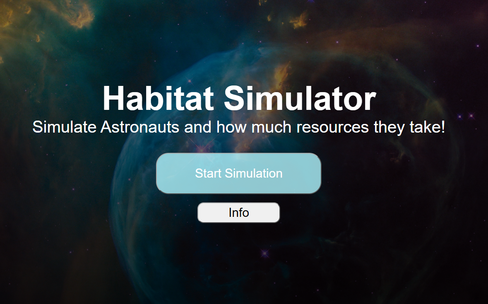
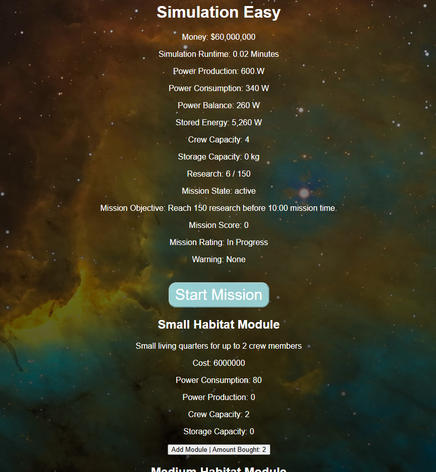

# Habitat Simulator

Habitat Simulator is a interactive web-based simulation of astronuat habitation.

# Photos

 - Start Page
 - Action

# Try It

Test the simulation here:
https://sleepyterrence1.github.io/HabitatSimulator/

# Features
- Ability to choose your difficulty
- Tracks your progress in real time
- Summary Page
- Easy to start and fun to play!

# Credits / acknowledgements
I personally used AI to get me going on most of the project and also to code some of my simulation. AI was a huge help in this and I've learn't a lot about Javascript!